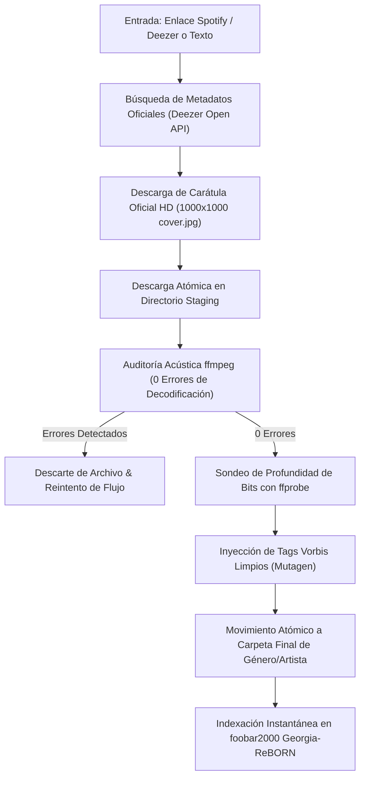

# 🎵 SpotiFLAC Hi-Res Engine

[](#audio-quality-standards)
[](#acoustic-integrity-gate)
[](#modern-audiophile-desktop-gui)
[](#zero-daemon-philosophy)
[](#foobar2000-integration)
[](LICENSE)

**SpotiFLAC Hi-Res Engine** is an audiophile-grade personal music downloader, curator, and library manager. It was engineered to overcome the critical limitations of standard streaming scrapers (such as public proxy rate limits, HTTP 429 errors, stream truncations, phantom empty folders, and homonym mixups), delivering genuine **Studio Master Hi-Res 24-bit** and **Red Book CD Lossless FLAC 16-bit** audio directly into an organized vault.

---

## ✨ Key Features

* **Transparent Audio Fidelity & Anti-Upsampling Protection**:
  * ⭐ **Hi-Res Studio Master (24-bit / 48–192 kHz)**: Preserved natively without downsampling for genuine lossless master files.
  * 💿 **CD Lossless (16-bit / 44.1 kHz)**: Standard Red Book CD audio quality.
  * 🎧 **Acoustic Integrity & Honest Tagging**: Detects stream source codecs on-the-fly (`STREAM_INFO: Opus/AAC`). Automatically prevents artificial 24-bit container bloat by encoding streaming audio into clean 16-bit FLAC, saving ~50% disk storage while tagging exact source fidelity (`SOURCE_CODEC`, `AUDIO_FIDELITY`).
* **Automated Anti-Bot & JS Challenge Solver**:
  * Seamless integration with Node.js EJS solver (`--remote-components ejs:github`) and browser session authentication to prevent *"Sign in to confirm you're not a bot"* rate blocks.
* **Per-Track Performer & Collaborative Search**:
  * Resolves per-track guest and collaborative artists on split or multi-artist albums to guarantee 100% track retrieval rates.
* **Acoustic Integrity Gate & Automated Repair**:
  * Every audio file is audited on-the-fly with an end-to-end decode pass using `ffmpeg -v error -i <file> -f null -`. Files with even 1 byte of corruption are discarded and re-downloaded from alternate streams.
  * **Incomplete Album & Sequence Gap Detection**: Automatically detects albums with missing audio files, ghost cover-only folders (`cover.jpg` with 0 songs), numbering sequence gaps (e.g. tracks 1, 3, 4 present, 2 missing), and truncated/aborted downloads (`.part`, `.ytdl`, or truncated FLACs).
  * **Surgical Auto-Repair Engine**: Resolves metadata and downloads exclusively the missing songs directly into the album's folder, verifying existing audio files in milliseconds without re-downloading what is already intact.
* **Modern Desktop GUI (PyWebView & Edge WebView2)**:
  * Glassmorphism dark theme inspired by Spotify and SpotiFLAC.
  * Interactive Discography Explorer with smart local library diffing and checkbox multi-selection.
  * Real-time download progress bar and per-track acoustic verification status badges.
  * 1000x1000 HD cover art previews and album metadata inspection.
  * Direct 1-click launcher for foobar2000 Georgia-ReBORN.
* **Full Discography & Multi-Select Engine**:
  * Download complete discographies or select specific albums via interactive checkboxes with real-time library comparison (`✅ En Biblioteca` vs `⏳ Pendiente`).
* **Discography Anchoring & Homonym Protection**:
  * Cross-references Deezer and Spotify catalog IDs to prevent homonym collisions (e.g. Bobby Liebling's US Pentagram vs Turkish Pentagram).
* **Official HD Artwork & Vorbis Comments**:
  * Automatically fetches 1000x1000 pixel `cover.jpg` for every release.
  * Injects complete Vorbis Comments (`TITLE`, `ARTIST`, `ALBUM`, `DATE`, `TRACKNUMBER`, `TRACKTOTAL`, `GENRE`).
* **Zero Background Daemons**:
  * 100% on-demand. When the application or batch script is closed, zero processes or background services remain active in Windows.
* **Strict Hierarchy Contract**:
  ```
  D:\MUSICA\<Género>\<Artista>\[<Año>] <Álbum>\<Pista:02d> - <Artista> - <Título>.flac
  ```

---

## 🏛️ Pipeline Architecture



---

## 🖥️ Modern Audiophile Desktop GUI

Launch the desktop interface with a single double-click on **`INICIAR_APP.bat`** (or execute `python app.py`).

### Features:
1. **Search & Download Tab**:
   * Accepts Spotify album/track URLs, Deezer URLs, or plain text (`Artist - Album`).
   * Fetches official tracklists, release year, genre, and 1000x1000 artwork.
   * Real-time progress bar with per-track status badges (`⏳ Pendiente`, `⬇️ Descargando...`, `🛡️ Auditando ffmpeg...`, `⭐ Hi-Res FLAC`).
2. **Interactive Discography Explorer & Multi-Select Batch Downloader**:
   * Discover complete studio discographies with one click using the dedicated **`Discografía`** search button or by clicking any artist card in the Library Monitor.
   * **Smart Library Diffing**: Instantly compares online catalogs against your local music vault, marking existing albums as `✅ En Biblioteca` (with audited track counts) and pending releases as `⏳ Pendiente`.
   * **Interactive Checkbox Multi-Selection**: Select or deselect albums individually by clicking cards or checkboxes with real-time glow feedback.
   * **Batch Action Toolbar**: Includes `☑️ Marcar Todos` (Select All), `⬜ Desmarcar` (Clear All), and a live counter button `⚡ Descargar Seleccionados (X) en Hi-Res` to queue and download only your chosen releases in sequence.
   * **Per-Album Discrete Actions**: Quick-download buttons on each individual card to download single albums without leaving the discography view.
3. **Library Monitor Tab**:
   * Displays live metrics of your collection (cataloged artists, audited albums, FLAC track count, and Hi-Res percentage).
   * 1-Click Library Update button to detect new studio releases across all cataloged artists.
   * Quick-launch artist cards from the verified disambiguation catalog.
4. **Acoustic Audit Tab**:
   * Real-time verification log showing stream decoding and bit-depth status.
5. **foobar2000 Integration**:
   * Integrated sidebar launcher for portable foobar2000 with Georgia-ReBORN theme.

---

## 🚀 Quick Start & Usage

### 1. Requirements
* Windows 10 / 11
* Python 3.10+
* `ffmpeg` and `ffprobe` in system PATH
* Install dependencies:
  ```bash
  pip install -r requirements.txt
  ```

### 2. Launch GUI (Recommended)
Double-click `INICIAR_APP.bat` or run:
```bash
python app.py
```

### 3. Complete Artist Discography Download (1-Click)
Double-click `DESCARGAR_DISCOGRAFIA.bat` or run:
```bash
python descargar_discografia.py "Acid Bath"
```
Or paste a Spotify/Deezer artist URL. Automatically resolves the entire studio discography, checks your library to skip existing albums, and downloads all missing albums in Hi-Res with official 1000x1000 artwork.

### 4. Interactive Single Release Download (1-Click)
Double-click `DESCARGAR_MUSICA.bat` or run:
```bash
python descargar_musica.py "Electric Wizard - Dopethrone"
```
Or pass a Spotify / Deezer URL. The engine handles metadata, HD artwork, downloading, auditing, tagging, and folder organization automatically.

### 5. Library Monitor & Automatic Updater (1-Click)
Double-click `ACTUALIZAR_BIBLIOTECA.bat` or run:
```bash
python actualizar_biblioteca.py
```
Scans all cataloged artist folders in parallel, discovers official new studio releases, downloads them in Hi-Res/Lossless FLAC, and logs updates.

### 6. Incomplete Album & Track Gap Repair (1-Click)
Double-click `REPARAR_INCOMPLETOS.bat` or run:
```bash
# Repair batch of 10 incomplete albums
python actualizar_biblioteca.py --reparar-incompletos --limite 10

# Repair all incomplete albums across the entire vault
python actualizar_biblioteca.py --reparar-incompletos

# Repair a specific artist
python actualizar_biblioteca.py --reparar-incompletos --artista "Accept"

# Audit only and generate _ALBUMES_INCOMPLETOS_DETECTADOS.txt
python actualizar_biblioteca.py --auditar
```
Detects ghost albums with only `cover.jpg`, sequence gaps (e.g. tracks 1, 3 present, 2 missing), and truncated downloads, and downloads only the missing tracks directly into their official library folders.

---

## 📁 Repository Structure

```
.
├── core/
│   ├── auditor.py              # Acoustic verification, integrity audit & Vorbis tagging
│   └── engine.py               # Multi-source failover downloader & staging manager
├── data/
│   └── known_artists.json      # Disambiguation catalog for homonyms
├── ui/
│   ├── index.html              # Desktop GUI interface layout
│   ├── style.css               # Glassmorphism dark theme styling
│   └── app.js                  # Frontend bridge controller
├── app.py                      # Desktop GUI application (PyWebView)
├── INICIAR_APP.bat             # 1-click GUI desktop launcher
├── DESCARGAR_DISCOGRAFIA.bat   # 1-click full discography downloader
├── descargar_discografia.py    # Complete discography downloader script
├── ACTUALIZAR_BIBLIOTECA.bat   # 1-click batch library updater
├── actualizar_biblioteca.py    # Library updater & incomplete repair script
├── REPARAR_INCOMPLETOS.bat     # 1-click incomplete albums & track gap repair
├── DESCARGAR_MUSICA.bat        # 1-click interactive CLI downloader
├── descargar_musica.py         # Interactive CLI downloader script
├── _ALBUMES_INCOMPLETOS_DETECTADOS.txt # Live audit report of incomplete releases
├── requirements.txt            # Python dependencies
├── .gitignore                  # Audio, images, cache & local exclusion rules
└── LICENSE                     # MIT License
```

---

## 📄 License
This project is open-source under the [MIT License](LICENSE).
